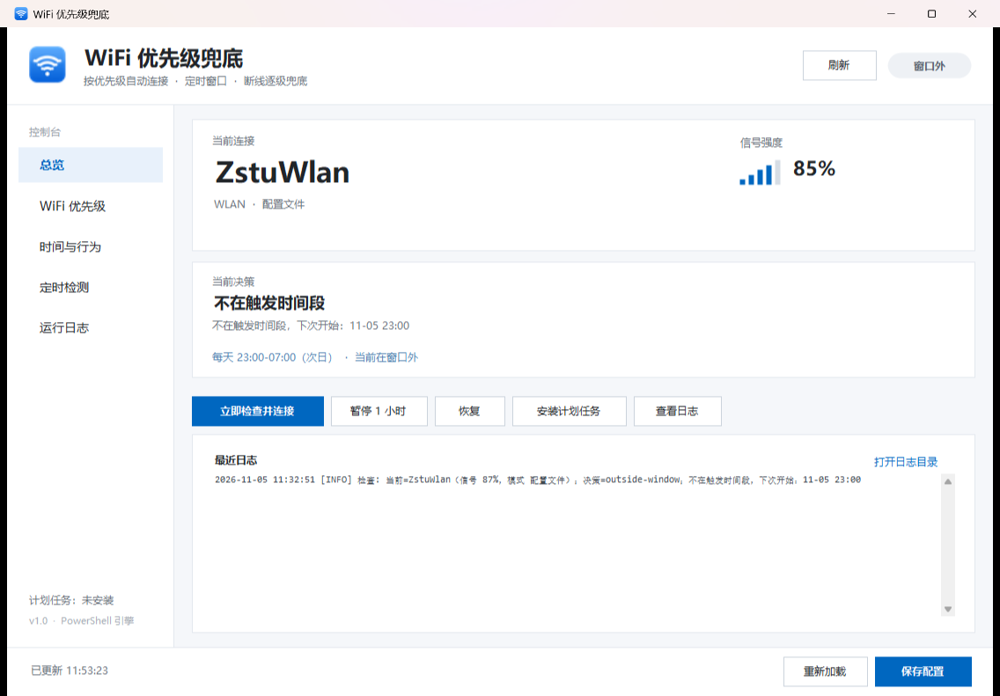
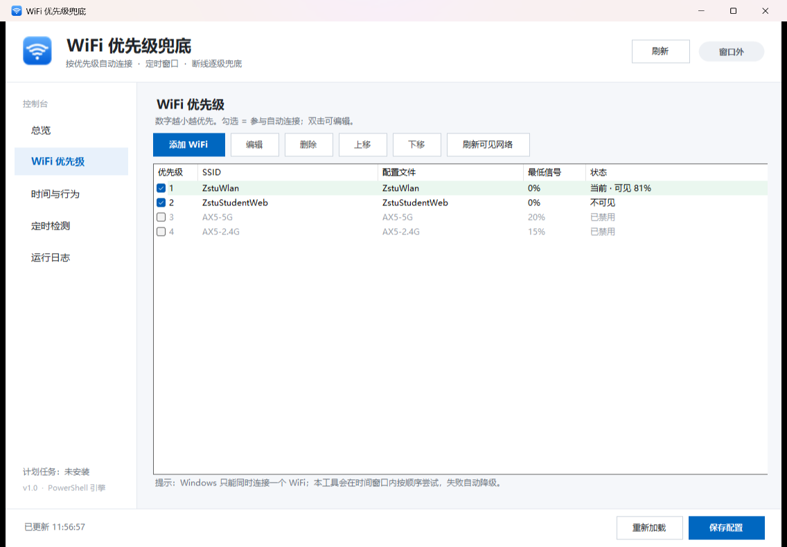
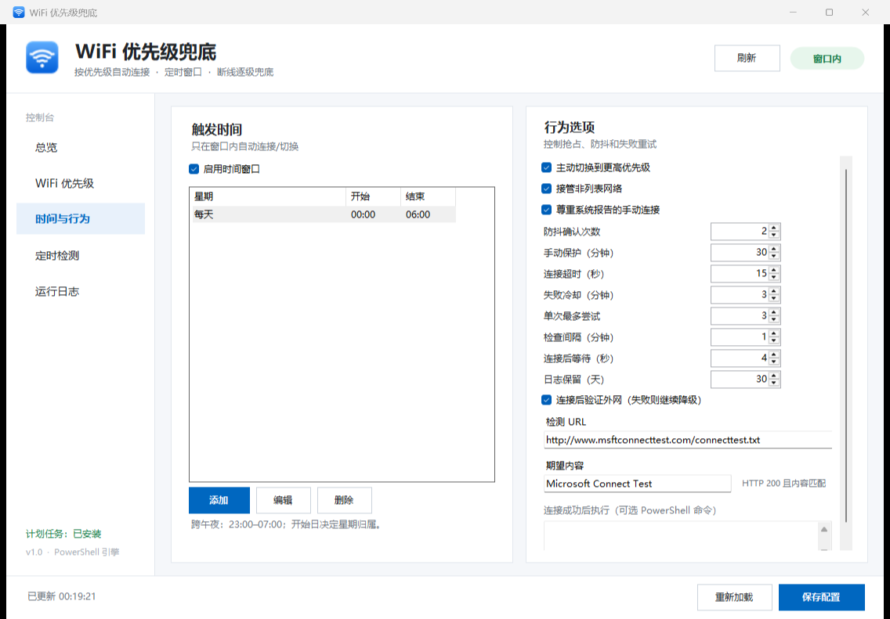
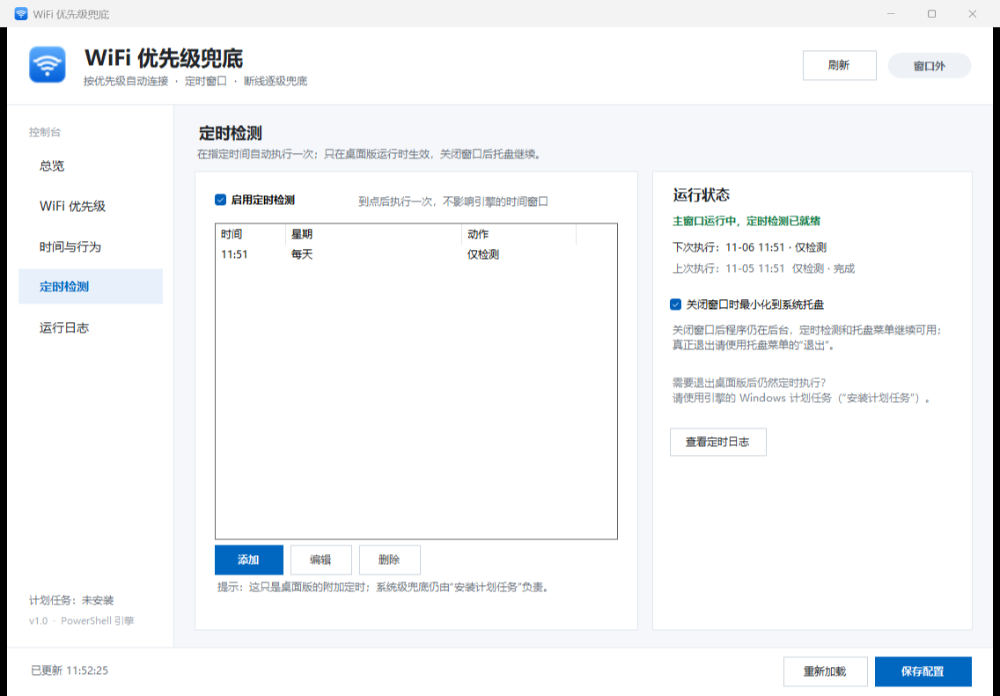

# Windows 多 WiFi 优先级兜底（定时窗口）

[](https://github.com/c1earhate/wifi-fallback/actions/workflows/build.yml)

仓库地址：<https://github.com/c1earhate/wifi-fallback>

下载：<https://github.com/c1earhate/wifi-fallback/releases/latest>

在 Windows 11 / Windows 10 上，用系统自带的 `netsh` + 计划任务实现：

- 配置多个 WiFi，按优先级从高到低连接；
- 高优先级 WiFi 断开 / 不可用时，自动依次尝试低优先级；
- 只在设定的时间段内生效，避免和白天手动操作冲突；
- 连接记录写入日志，可随时暂停、恢复、查看决策。

不需要安装第三方软件，不需要管理员权限，不保存任何 WiFi 密码（使用系统里已经保存的配置文件）。

项目同时提供**可视化桌面版** `WifiFallbackUI.exe`：双击即可查看状态、编辑优先级和时间窗口、暂停、安装计划任务，不用记命令行参数。

---

## 1. 文件说明

| 文件 | 作用 |
| --- | --- |
| `WifiFallbackUI.exe` | 桌面版图形界面（构建产物；可直接下载 Releases 里的 zip） |
| `WifiFallback.ps1` | 主程序：状态、决策、连接、计划任务 |
| `config.json` | 本地运行配置：WiFi 列表、优先级、时间窗口（已被 git 忽略） |
| `config.example.json` | 示例配置，首次使用复制为 `config.json` |
| `LICENSE` | MIT 许可证 |
| `.github/workflows/build.yml` | GitHub Actions：编译 exe 并运行测试 |
| `wifi.cmd` | 命令包装，方便输入 `.\wifi.cmd -Status` |
| `run-hidden.vbs` | 计划任务用的隐藏启动器（`-InstallTask` 自动生成） |
| `state.json` | 运行时状态（上次连接、失败冷却、暂停），自动生成 |
| `ui-settings.json` | 桌面版设置：托盘、定时检测；在界面里修改后自动生成 |
| `logs\wifi-fallback-YYYY-MM.log` | 运行日志，按天/月自动清理 |
| `tests\WifiFallback.Tests.ps1` | 决策逻辑自测，不连接真实 WiFi |
| `build.ps1` | 重新编译桌面版 |
| `src\` | 桌面版的 C# 源码、图标和清单 |
| `docs\screenshot-*.png` | 界面截图 |

环境要求：Windows 10/11，PowerShell 5.1（系统自带），WLAN AutoConfig 服务正常运行。桌面版基于 .NET Framework 4.8（Windows 10/11 自带），不需要安装运行时。

---

## 2. 快速开始

### 2.1 桌面版（推荐）

首次使用先把示例配置复制为本地配置（仓库不会提交包含个人 WiFi 的 `config.json`）：

```powershell
Copy-Item .\config.example.json .\config.json
```

也可以直接下载 [Releases](https://github.com/c1earhate/wifi-fallback/releases/latest) 里的 `WifiFallback-v1.0.0-win64.zip`，解压后双击 `WifiFallbackUI.exe`。

程序需要和 `WifiFallback.ps1`、`config.json` 放在同一个目录。



- **总览**：当前连接、信号、时间窗口状态、本次决策；一键刷新、立即检查、暂停 1 小时、恢复、安装/卸载计划任务。
- **WiFi 优先级**：添加、编辑、删除、上移、下移，勾选是否参与自动连接；添加时下拉框会列出扫描到的网络和系统已保存的配置。
- **时间与行为**：编辑时间窗口和抢占、防抖、失败冷却、检查间隔等参数，以及连接成功后的 Portal 认证命令。
- **定时检测**：在指定时间执行一次“仅检测”或“检测并连接”；关闭窗口后托盘继续执行。
- **运行日志**：查看最近日志、打开日志目录。







窗口右上角的关闭按钮默认**不会退出程序**，而是隐藏到系统托盘，定时检测继续运行。托盘图标右键可以打开主界面、立即检查、暂停/恢复、启用定时检测和退出；双击托盘图标也可以打开。真正退出请使用托盘菜单里的“退出”。

使用顺序：

1. 在“WiFi 优先级”里用“上移/下移”调整顺序，或点“添加 WiFi”。
2. 在“时间与行为”里设置窗口，勾选“启用时间窗口”。
3. 点右下角“保存配置”。
4. 点“安装计划任务”。安装后任务每分钟检查一次，窗口外完全不动作。
5. 关闭窗口不会停止计划任务；需要停止时再点“卸载计划任务”。
6. 可选：在“定时检测”里添加时间，让桌面版在指定时刻额外执行一次检测。

桌面版是控制面板 + 托盘常驻程序。窗口关闭到托盘时，定时检测由桌面版自己执行；由 Windows 计划任务负责的兜底即使真正退出桌面版也仍然有效。

### 2.2 命令行

在项目目录打开 PowerShell：

```powershell
# 1) 看当前状态（不会做任何修改）
.\wifi.cmd -Status

# 2) 编辑 config.json，确认 WiFi、优先级、时间窗口

# 3) 模拟运行：只显示“如果现在触发会怎么做”
.\wifi.cmd -Plan

# 4) 真实连接测试（会切换当前 WiFi）
.\wifi.cmd -ConnectTo "ZstuWlan"

# 5) 安装计划任务（当前用户，每分钟检查一次）
.\wifi.cmd -InstallTask

# 卸载计划任务
.\wifi.cmd -UninstallTask
```

如果 PowerShell 提示禁止运行脚本，用：

```powershell
powershell -NoProfile -ExecutionPolicy Bypass -File ".\WifiFallback.ps1" -Status
```

`wifi.cmd` 内部已经带了 `-ExecutionPolicy Bypass`，通常直接可用。

---

## 3. 工作逻辑

每次检查（默认每 1 分钟）：

1. 如果处于暂停状态 → 不动作。
2. 如果当前不在 `schedule.windows` 内 → 不动作。
3. 读取当前连接、扫描可见 WiFi。
4. 按 `priority` 从小到大排列**可见、信号达标、不在失败冷却**的网络。
5. 当前未连接：依次尝试候选网络，成功即停；失败进入冷却，下一次尝试下一个。
6. 当前已连接：
   - 已经是最高优先级 → 保持不动；
   - 发现更高优先级，且连续 `preemptDelayChecks` 次确认 → 切换；
   - 当前是非列表网络 → 由 `preemptUnknown` 决定是否接管；
   - 手动连接保护 / 暂停期间 → 不动作。
7. 如果抢占失败且原来有连接，会尽力恢复原网络，避免“抢网失败反而断网”。

几个关键设计：

- **优先级数字越小越高**，例如 1 最高。
- **防抖**：默认连续 2 次检查到更高优先级才切换，避免信号闪烁导致来回跳。
- **失败冷却**：某个 SSID 连接失败后，默认 3 分钟内不再优先尝试它，直接走后一个。
- **时间窗口**：`days` 指窗口“开始”的那一天；`start > end` 表示跨到第二天（例如 23:00–07:00）。
- **手动保护**：如果系统报告当前连接是手动发起的（`Connection mode: Manual`），且不是本工具刚连上的 SSID，则暂停自动切换 `manualGraceMinutes` 分钟。
- **兜底恢复**：抢占失败会尝试恢复原连接。

---

## 4. 配置说明

```json
{
  "interface": "",
  "networks": [
    { "ssid": "ZstuWlan",        "profile": "ZstuWlan",        "priority": 1 },
    { "ssid": "ZstuStudentWeb",  "profile": "ZstuStudentWeb",  "priority": 2 },
    { "ssid": "AX5-5G",          "profile": "AX5-5G",          "priority": 3, "enabled": false }
  ],
  "schedule": {
    "enabled": true,
    "windows": [
      { "days": ["Mon","Tue","Wed","Thu","Fri","Sat","Sun"], "start": "23:00", "end": "07:00" }
    ]
  },
  "behavior": {
    "preempt": true,
    "preemptUnknown": true,
    "preemptDelayChecks": 2,
    "respectManualMode": true,
    "manualGraceMinutes": 30,
    "connectTimeoutSec": 15,
    "failedRetryMinutes": 3,
    "maxAttemptsPerRun": 3,
    "onConnectCommand": "",
    "taskIntervalMinutes": 1
  }
}
```

### 4.1 顶层

| 字段 | 说明 |
| --- | --- |
| `interface` | 无线网卡名称，例如 `WLAN`；留空自动选择。多网卡时建议填写。 |

### 4.2 `networks[]`

| 字段 | 默认 | 说明 |
| --- | --- | --- |
| `ssid` | 必填 | WiFi 名称 |
| `profile` | 同 `ssid` | Windows 里保存的配置文件名称；通常与 SSID 相同 |
| `priority` | 数组顺序 | 越小越优先 |
| `enabled` | `true` | `false` 表示不参与 |
| `minSignal` | `0` | 最低信号百分比，低于它不作为候选 |
| `allowHidden` | `false` | 隐藏 SSID：扫描不到时也尝试连接（会多等一个超时） |

### 4.3 `schedule`

| 字段 | 说明 |
| --- | --- |
| `enabled` | `false` 表示全天生效（不推荐，容易和手动操作冲突） |
| `windows[].days` | 窗口开始日：`Mon`…`Sun`、`周一`…`周日`、`*` / `每天` |
| `windows[].start` / `end` | `HH:mm`；`start > end` 表示跨午夜；`start == end` 表示 24 小时 |

示例：

```json
"windows": [
  { "days": ["Mon","Tue","Wed","Thu","Fri"], "start": "23:30", "end": "07:30" },
  { "days": ["Sat","Sun"],                   "start": "00:00", "end": "09:00" }
]
```

注意：第一天 23:30 开始的窗口，`days` 写周一，周二凌晨 1 点仍然算在窗口内。

### 4.4 `behavior`

| 字段 | 默认 | 说明 |
| --- | --- | --- |
| `preempt` | `true` | 已连接低优先级时，是否主动切到更高优先级 |
| `preemptUnknown` | `true` | 当前是非列表网络时，是否按优先级接管 |
| `preemptDelayChecks` | `2` | 连续确认次数；1 分钟任务下约等于 2 分钟 |
| `respectManualMode` | `true` | 尊重系统报告的 Manual 连接 |
| `manualGraceMinutes` | `30` | 手动连接保护时长 |
| `connectTimeoutSec` | `15` | 单个网络连接等待秒数 |
| `postConnectDelaySec` | `4` | 连接成功后等待 DHCP/认证再执行命令 |
| `failedRetryMinutes` | `3` | 连接失败后的冷却时间 |
| `maxAttemptsPerRun` | `3` | 单次检查最多尝试几个候选 |
| `verifyInternet` | `false` | 连接后是否做 TCP 连通性检查 |
| `verifyHost` / `verifyPort` | `223.5.5.5` / `443` | 连通性检查目标 |
| `onConnectCommand` | 空 | 连接成功后执行的 PowerShell 命令，见校园网 Portal 部分 |
| `logKeepDays` | `30` | 日志保留天数 |
| `taskIntervalMinutes` | `1` | 计划任务检查间隔，修改后需要重新 `-InstallTask` |

---

## 5. 校园网场景

### 5.1 普通校园网（Open / WPA2 / 802.1X）

只要 Windows 里已经保存过该 WiFi 的配置文件，工具就能直接连接。第一次连接、证书确认、账号密码输入仍然由 Windows 完成。

检查配置文件是否已保存：

```powershell
netsh wlan show profiles
```

`-InstallTask` 也会提示哪些 `profile` 在系统里不存在。

### 5.2 网页 Portal 认证

很多校园网连上 WiFi 后还要在网页上登录。可以配置 `onConnectCommand`，连接成功后自动执行：

```json
"onConnectCommand": "Invoke-WebRequest -UseBasicParsing -Uri 'http://10.0.0.1/login?user=学号&pass=密码' | Out-Null"
```

命令里可以使用环境变量：

- `$env:WIFI_SSID`：刚连上的 SSID
- `$env:WIFI_PROFILE`：配置文件名称

建议把认证逻辑写成单独的 `portal-login.ps1`，这里只调用：

```json
"onConnectCommand": "& 'D:\\1\\WifiFallback\\portal-login.ps1'"
```

注意：把密码写进配置是明文；更安全的做法是让脚本从 Windows 凭据管理器读取。

### 5.3 隐藏 SSID

在该条配置里加 `"allowHidden": true`。隐藏网络扫描不到时也会尝试连接，但每次会多等一个 `connectTimeoutSec`。

### 5.4 多个无线网卡

在 `interface` 填网卡名称，例如：

```json
"interface": "WLAN"
```

名称可以用 `netsh wlan show interfaces` 或 `Get-NetAdapter` 查看。

---

## 6. 与 Windows 自带机制的关系

Windows 本身有两个相关能力：

1. **配置文件优先级**：`netsh wlan set profileorder name="ZstuWlan" interface="WLAN" priority=1`，只能调整系统自动连接时的偏好顺序。
2. **自动连接**：每个配置文件里的“自动连接”和 `AutoSwitch` 选项。

它们的问题：

- 没有时间窗口，任何时候都会自动连；
- 不能保证“断开后按顺序逐个尝试并重试”；
- 没有失败冷却、日志、手动保护；
- 不会在低优先级连接稳定时主动抢回高优先级。

本工具是在系统自动连接之上的“调度器”：Windows 仍然可以自己连，工具在窗口内负责把连接纠正到正确的优先级。

如果只想用系统自带方案，可以执行上面的 `profileorder` 命令，并确保各配置文件都勾选“自动连接”。但它无法满足定时和兜底顺序的要求。

---

## 7. 常用命令

```powershell
.\wifi.cmd -Status                     # 状态、优先级、当前决策
.\wifi.cmd -Plan                       # 模拟运行（忽略时间窗口）
.\wifi.cmd -Run -Force                 # 强制执行一次（忽略时间窗口）
.\wifi.cmd -ConnectTo "ZstuWlan"       # 立即连接指定 SSID
.\wifi.cmd -Pause -Minutes 120         # 暂停 2 小时
.\wifi.cmd -Resume                     # 取消暂停
.\wifi.cmd -InstallTask                # 安装计划任务
.\wifi.cmd -UninstallTask              # 删除计划任务
.\wifi.cmd -InstallTask -TaskName "MyWifiFallback"   # 自定义任务名
```

安装后计划任务名为 `WifiFallback`，登录后约一分钟内开始，之后每 `taskIntervalMinutes` 分钟运行一次。任务以当前用户身份运行，不需要管理员权限，也不会在未登录时运行。

---

## 8. 常见问题

**Q：为什么切换要等一两分钟？**
任务默认每分钟检查一次；扫描结果有缓存；抢占还有 2 次防抖。把 `preemptDelayChecks` 改为 1 可以更快，但更容易因信号抖动来回切换。

**Q：会不会和手动连接打架？**
有三层保护：只在时间窗口内动作；系统报告 Manual 连接时进入保护期；随时可以 `-Pause`。如果发现仍然冲突，可以把窗口调窄，或把 `preemptUnknown` 设为 `false`（当前是非列表网络时完全不接管）。

**Q：点击右上角关闭后程序还在运行吗？**
默认会。窗口会隐藏到系统托盘，定时检测继续执行；只有托盘菜单里的“退出”才真正结束进程。可以在“定时检测”页取消“关闭窗口时最小化到系统托盘”，这样关闭按钮会直接退出。

**Q：定时检测和“安装计划任务”有什么区别？**
定时检测是桌面版的附加功能，只在 `WifiFallbackUI.exe` 运行时生效（包括隐藏在托盘时）；计划任务由 Windows 调度，退出桌面版后仍然执行，并且按 config 的时间窗口持续兜底。两者可以同时使用。

**Q：计划任务显示运行成功，但没有切换？**
先看日志。最常见原因是“不在窗口内”或“已经是最优网络”。用 `-Plan` 可以看到忽略窗口后的决策。

**Q：任务计划程序里提示 Access denied？**
本工具的 `-InstallTask` 只用当前用户权限，不需要管理员。若仍失败，检查是否被杀毒软件/组策略拦截了 `wscript.exe` 或计划任务创建。可以改用“启动”文件夹放 `run-hidden.vbs` 的快捷方式作为替代。

**Q：电脑睡眠时会执行吗？**
不会。唤醒后下一次计划任务会继续检查；如果已经错过整个时间窗口，就不会再动作。

**Q：支持 5GHz/2.4GHz 同名 SSID 吗？**
Windows 按 SSID 管理，同名会视为同一个网络；优先级按 SSID 配置。

**Q：移动了文件夹怎么办？**
计划任务里保存的是绝对路径，移动后需要重新 `-InstallTask`。

**Q：怎么完全删除？**
先 `.\wifi.cmd -UninstallTask`，再删除整个 `WifiFallback` 文件夹即可。工具没有写注册表、没有安装服务。

**Q：怎么重新编译桌面版？**
先关闭正在运行的 `WifiFallbackUI.exe`，然后：
```powershell
powershell -ExecutionPolicy Bypass -File .\build.ps1
```
使用 Windows 自带的 .NET Framework 4.x 编译器（`csc.exe`），不需要 Visual Studio。源码在 `src\`，图标和清单也在里面。

**Q：日志在哪里？**
`logs\wifi-fallback-YYYY-MM.log`。状态文件是 `state.json`，删除它相当于清空失败冷却、暂停和上次连接记录。

---

## 9. 已验证的行为

在本机（Windows 11 26100、PowerShell 5.1、Intel AX200、校园网 `ZstuWlan` / `ZstuStudentWeb`）上实际测试：

- 断开 WiFi 后 Windows 自动连到优先级 2 的 `ZstuStudentWeb`；
- 工具下一次检查发现 `ZstuWlan` 可见，第一次记录“确认中（1/2）”，第二次成功切换到 `ZstuWlan`；
- `netsh wlan connect` 返回成功，约 1 秒完成关联，日志记录完整；
- 计划任务以隐藏窗口运行，日志正常写入，任务结果 `0x0`；
- 桌面版可以读取状态、保存配置、暂停/恢复、安装/卸载计划任务；安装后任务状态和运行日志都能在界面里看到；
- 点击窗口关闭按钮后进程留在托盘，窗口隐藏；再次双击 exe 或托盘图标可以恢复；托盘菜单可退出；
- 定时检测在 11:51 执行“仅检测”，写入 `logs\ui-timed.log`，界面显示上次执行和下次执行；另一次“检测并连接”在 11:55 触发引擎强制检查（already-best），UI 日志和引擎日志都有记录；
- 关闭窗口隐藏到托盘后，定时检测仍按时执行（实测窗口不可见状态下 11:58 触发并写入日志）；
- 30 项决策/时间窗口/冷却/隐藏网络测试全部通过。

隐藏窗口、无控制台环境下 `netsh` 的输出编码和交互式控制台不同。脚本现在直接读取 `netsh` 的原始字节，先按 UTF-8 解码，失败再回退到系统 ANSI 代码页，避免中文系统下出现“找不到无线网卡”。

---

## 10. 安全与限制

- 不保存 WiFi 密码，依赖 Windows 已保存的配置文件。
- 不修改 WiFi 配置文件、不修改系统代理、不写注册表。
- 计划任务以当前用户身份运行，仅在该用户登录时生效。
- 桌面版保存配置时会保留 `_说明` 并生成 `config.json.bak` 备份；写入格式是格式化的 JSON（days 会写成数字 1–7，引擎同样支持）。
- 桌面版未做代码签名，SmartScreen 可能会在首次运行时提示；确认文件来源后选择“仍要运行”即可。
- 校园网 Portal 认证的账号密码如果写进 `onConnectCommand`，会以明文保存在 `config.json`，请自行评估。
- 本工具只负责“连哪个 WiFi”，不负责 Portal 认证、DNS、代理等上层网络配置。

---

## 11. 构建、CI 与许可证

- 桌面版构建：`powershell -ExecutionPolicy Bypass -File .\build.ps1`（Windows 自带 .NET Framework 4.x 的 `csc.exe`）。
- 引擎测试：`powershell -ExecutionPolicy Bypass -File .\tests\WifiFallback.Tests.ps1`。
- GitHub Actions 会在每次 push / PR 时编译 `WifiFallbackUI.exe`、运行 30 项测试并上传构建产物。
- 许可证：[MIT](LICENSE)。欢迎提 Issue 或 PR。